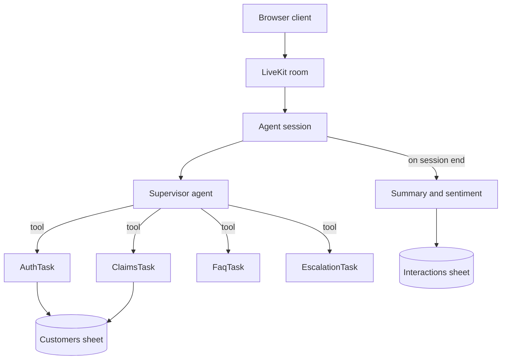

# Customer Support Voice Agent

An inbound claims support voice agent for an insurance company. Callers talk to it in a browser, in **English or Hindi**, and can interrupt it at any time. It verifies who is calling, reads out claim status, answers common questions, hands off to a human when asked, handles emergencies safely, and writes a record of every call to a spreadsheet.

Built on [LiveKit Agents](https://docs.livekit.io/agents/) with a supervisor agent that routes work to specialist tasks.

## Features

- **Identity verification.** Phone number lookup, then a PIN check. Decided in code, never by the model.
- **Claim status.** Status and document-submission steps, only after the caller is verified.
- **FAQ.** Office hours, mailing address, how to start a claim, and the claims process. Available without verification.
- **Human escalation.** Asking for a representative arranges a callback. Works at any point in the call.
- **Emergency handling.** Danger phrases in English, Hindi, or romanized Hindi trigger a fixed safety message and skip the model entirely.
- **Bilingual.** Understands English, Hindi, and mixed speech. The reply voice follows the caller's language.
- **Barge-in.** Speaking over the agent stops it immediately. Verification progress is kept.
- **Call records.** Caller name, summary, sentiment, outcome, and timestamp are appended to a Google Sheet when the call ends, including when the caller just closes the tab.
- **Typed input.** The web client accepts typed text, which helps when a phone number is misheard.

## How it works



| Layer | Choice |
| --- | --- |
| Transport, turns, interruption, hosting | LiveKit Cloud |
| Speech to text | Sarvam realtime (English, Hindi, code-mixed). Deepgram Nova-3 is a one-variable swap |
| Text to speech | Cartesia Sonic |
| Language model | Any tool-calling model through OpenRouter |
| External system | Google Sheets, read for customers and appended for call records |
| Web client | Next.js, from LiveKit's `agent-starter-react` template |

The supervisor decides which specialist to run. Anything with security or safety consequences is enforced in code. See [docs/architecture.md](docs/architecture.md).

## Quickstart

Prerequisites: Python 3.10 to 3.13 with [uv](https://docs.astral.sh/uv/), Node 20+ with [pnpm](https://pnpm.io/), and the [LiveKit CLI](https://docs.livekit.io/intro/basics/cli/start/) (`brew install livekit-cli`).

```bash
# 1. Install dependencies and download model files
make setup

# 2. Add your keys. Names and meanings are in docs/configuration.md
$EDITOR .env

# 3. Run the agent against your LiveKit Cloud project
make dev

# 4. In a second terminal, run the browser client
$EDITOR web/.env.local     # set LIVEKIT_TOKEN_SERVER_ID (see docs/configuration.md)
make web                   # http://localhost:3000
```

You can try it without a spreadsheet. If `GOOGLE_SHEET_ID` is not set, the agent uses a seeded in-memory store with three sample customers (see [docs/scenarios.md](docs/scenarios.md)). Call records are then logged but not persisted. To use a real sheet, follow [docs/data-model.md](docs/data-model.md).

To talk to the agent from the terminal without a browser, run `make console`.

## Repository layout

```
agent/            Python LiveKit agent
  main.py           Server entry point and post-call hook
  agents/           Supervisor and specialist tasks
  integrations/     Google Sheets and in-memory stores
  prompts/          Agent instructions as Markdown
  kb/faq.yaml       Public FAQ answers, English and Hindi
  voice.py          Speech, language model, turns, interruption
  safety.py         Deterministic emergency detection
  postcall.py       Summary, sentiment, and the record write
  tests/            Unit tests and conversation-flow tests
web/              Browser client
data/sample/      CSV templates for the two sheet tabs
docs/             Architecture, configuration, deployment, and more
```

## Documentation

| Guide | What it covers |
| --- | --- |
| [Architecture](docs/architecture.md) | Supervisor and tasks, state, guards, interruption behavior |
| [Configuration](docs/configuration.md) | Every environment variable and where to get each key |
| [Data model](docs/data-model.md) | Sheet columns, service account setup, sample data |
| [Deployment](docs/deployment.md) | LiveKit Cloud deploy, secrets, free-plan notes, production hardening |
| [Testing](docs/testing.md) | Running tests, what each layer covers, optional simulations |
| [Scenarios](docs/scenarios.md) | Scripted calls with expected results |
| [Troubleshooting](docs/troubleshooting.md) | Common problems and fixes |

## Common commands

Run `make help` for the full list. The ones you will use most: `make dev`, `make console`, `make web`, `make test`, `make test-all`, `make deploy`.

## License

MIT. See [LICENSE](LICENSE). The web client is derived from LiveKit's MIT-licensed starter, whose notice is kept in [web/LICENSE](web/LICENSE).
