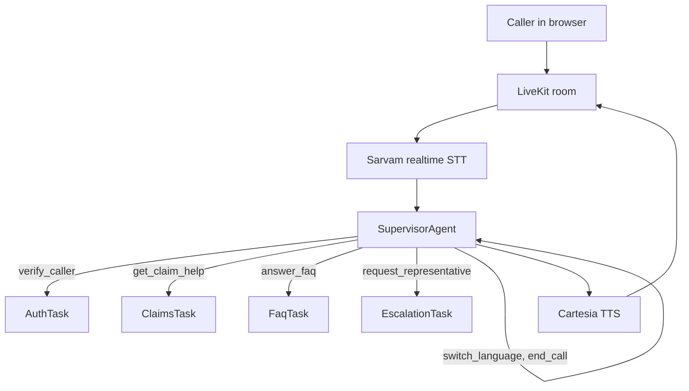

# Architecture

## Overview

One LiveKit agent session per call. A long-lived **supervisor** agent talks to the caller and decides which **specialist task** to run. Specialists take control of the session briefly, then return a typed result. Per-call state lives on `session.userdata`.

The pattern is LiveKit's [supervisor pattern](https://docs.livekit.io/agents/logic/patterns/supervisor/): the supervisor keeps the full conversation and the specialists are focused sub-conversations. A graph runtime is not needed, because the control flow is a small set of tool calls and the interesting state is a dataclass.

## Components

| Component | File | Role |
| --- | --- | --- |
| Supervisor | `agent/agents/supervisor.py` | Greets, routes with tools, ends the call |
| AuthTask | `agent/agents/auth.py` | Collects phone and PIN, returns `verified`, `not_found`, `auth_failed`, `unavailable`, or `aborted` |
| ClaimsTask, FaqTask, EscalationTask | `agent/agents/specialists.py` | Speak a fact-grounded answer once and return |
| Call state | `agent/state.py` | Verification, attempts, outcome flags, language |
| Emergency guard | `agent/safety.py`, `agent/agents/base.py` | Keyword detection and the shared fixed response |
| Voice pipeline | `agent/voice.py` | STT, LLM, TTS, turn handling, language follow |
| Post-call write | `agent/postcall.py`, `agent/main.py` | Summary, sentiment, and the sheet append |
| Stores | `agent/integrations/` | Google Sheets backend and an in-memory twin |

## What the model decides, and what code decides

The language model chooses which tool to call and phrases replies. Code owns everything where a mistake would matter.

| Decision | Owner |
| --- | --- |
| Which specialist to run | Model, through tool calls |
| Whether a PIN is correct | Code, in `AuthTask.submit_pin`, using a constant-time compare |
| Whether the caller may hear claim data | Code. `require_auth` refuses claim tools unless `state.authenticated` |
| How many verification attempts remain | Code, in `CallState` |
| Whether the caller is in an emergency | Code, in `safety.is_emergency` |
| What the emergency reply says | Fixed text in English and Hindi |
| Which facts a specialist may state | Code assembles the fact list from the sheet or FAQ. The model only phrases it |
| The call outcome in the record | Derived from state by `CallState.final_outcome()` |

The stored PIN is never placed in any prompt or tool result. A found-but-unverified account is held as `pending_customer` and only becomes `customer` after the PIN matches.

## Verification flow

1. The caller asks about a claim. The supervisor calls `verify_caller`, which starts `AuthTask`.
2. `submit_phone` normalizes the number (digits, spoken words, and Devanagari digits are all accepted) and looks it up. An unknown number gets one retry, then ends as `not_found`.
3. A found account is greeted by first name only. `submit_pin` allows two tries, then ends as `auth_failed`.
4. On any ending the task finishes silently with `StopResponse` and returns a typed result. The supervisor then speaks the outcome, so the caller hears a single voice.
5. After a failed or not-found result `verify_caller` refuses to run again for the rest of the call.

## Specialist tasks

`ClaimsTask`, `FaqTask`, and `EscalationTask` share one shape. The supervisor tool builds the facts, the task speaks them once in the active language with its own scoped instructions, and returns whether the caller interrupted. If the caller interrupted, the supervisor offers to repeat.

## Emergency handling

Emergency phrases (for example "chest pain", "not breathing", "सीने में दर्द", "aag lag gayi") trigger a fixed message that points to local emergency services (112 in India). The model turn is skipped. The same check runs on spoken turns (`EmergencyGuardMixin.on_user_turn_completed`) and on typed input (`voice.guarded_text_input`), because LiveKit's default text handler bypasses the turn hook. An emergency during verification aborts it. Words such as "accident" or "fire" alone are deliberately not triggers, since they are normal subjects of a claim.

## Language

Sarvam runs with automatic language detection and code-mixed output, so one stream handles English, Hindi, and mixed speech. A hook on final transcripts updates `state.language` and the Cartesia voice language. It ignores short or numeric utterances, so reading out digits does not flip the language. The caller can also ask to switch, which calls `switch_language`.

## Interruption

Interruptions are enabled. Speech that overlaps the agent cancels the current speech. Tasks and `userdata` are untouched, so an accepted PIN stays accepted. Adaptive interruption is used when available so short acknowledgements such as "okay" do not cut the agent off. Preemptive generation is off by default because verification attempts are counted by tool calls, which must not run on a speculative generation. It can be enabled with `PREEMPTIVE_GENERATION=true` for lower latency.

## Post-call record

LiveKit calls `on_session_end` after the voice pipeline closes, for every disconnect. The hook reads the session history, asks the model for a two-sentence summary and a sentiment label, removes long digit runs, and appends one row. A flag on the state prevents duplicates. If the model call fails or times out, a deterministic summary is written instead. If the sheet is unreachable the failure is logged and the call still ends cleanly.

## Failure behavior

| Failure | Behavior |
| --- | --- |
| Sheet unreachable during lookup | One retry, then `unavailable`. The agent apologizes and offers a callback |
| Sheet unreachable during write | Logged with the full record. The call is not affected |
| Summary model fails | Fallback summary and `neutral` sentiment |
| Caller disconnects mid-call | Record is still written |
| STT mishears digits | Caller can type them, or repeat digit by digit |

## Deliberate limits

- The callback is recorded, not a live transfer.
- Verification attempt limits are per call. Production should also rate limit per phone number across calls.
- PINs are stored in plain text in the sample sheet to keep the demo simple. See [deployment.md](deployment.md) for production notes.
